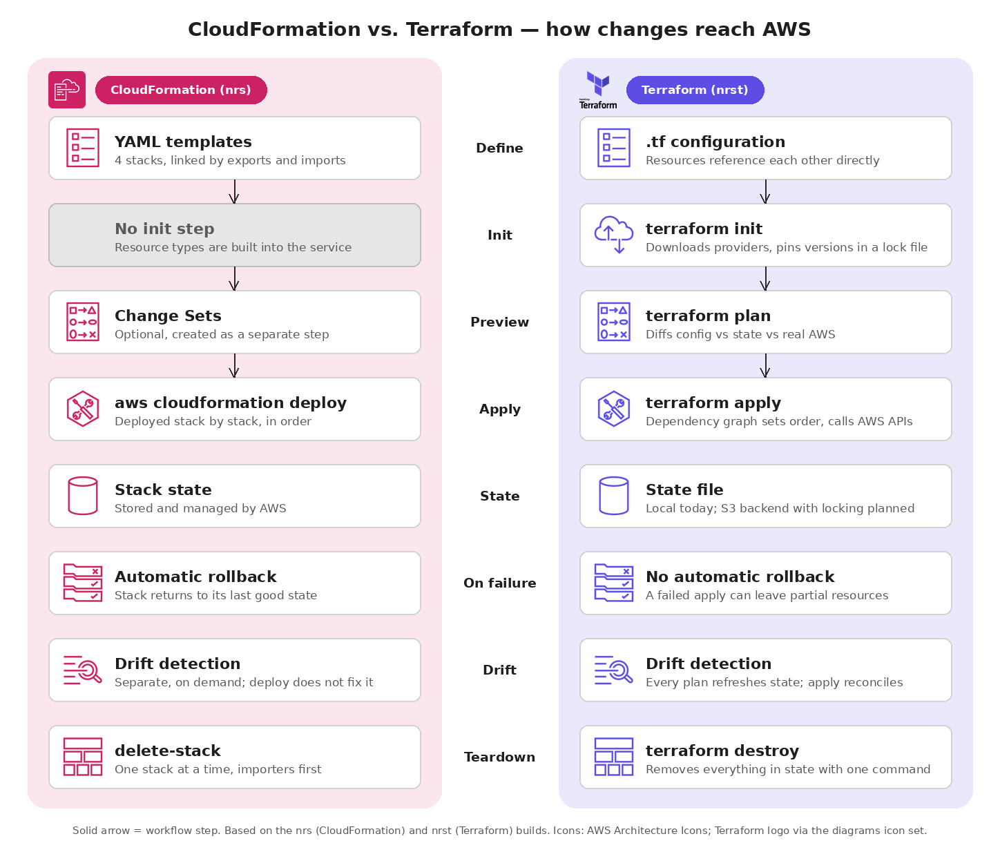
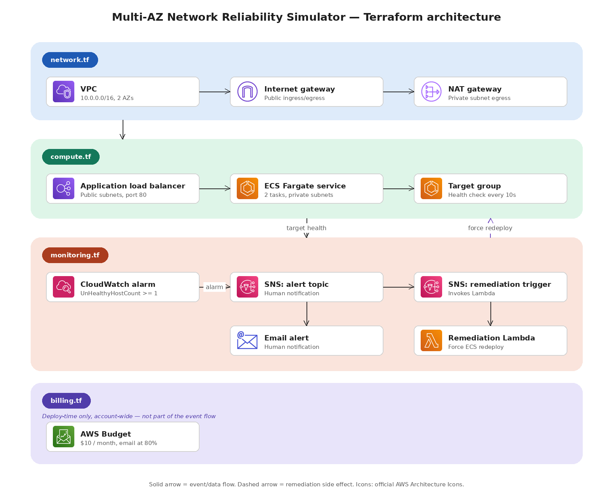

# Multi-AZ Network Reliability Simulator - Terraform

*Learning project #1b in a series - AWS / SRE fundamentals.*

A self-healing AWS network that detects a connectivity failure, alerts, and
tries to remediate it - built in Terraform to practice SRE concepts
(detection → alerting → remediation → observability) on top of enterprise
networking fundamentals: VPC design, security groups, load balancing,
multi-AZ redundancy.

This is the second implementation of the same project. The first one used
CloudFormation (see [Part 1](#part-1-the-cloudformation-version)).

## CloudFormation vs. Terraform: what is different here

Same architecture, same failure scenario, same alarm and Lambda logic. What
changes is how the infrastructure is defined, previewed, applied and kept in
sync:



**What changed in this build**

- Region `eu-north-1` (Part 1 used `eu-west-3`), prefix `nrst` instead of
  `nrs`.
- Deployed from the CLI with a dedicated least-privilege IAM user, not by
  hand in the console.
- One configuration with direct references between resources, instead of
  four stacks linked by exports and imports.
- The Lambda source is a real file (`lambda/remediation.py`), packaged by the
  `archive` provider.
- Recovery works differently. In Part 1 the failure script restored the
  security group rule itself. Here it only breaks the rule, and
  `terraform apply` repairs it, which makes drift visible.

**What Terraform gave me in practice**

- **`plan` before every change.** I saw exactly what would be created
  (`Plan: 6 to add`) before touching AWS. CloudFormation has Change Sets,
  but as a separate optional step.
- **Drift detection is part of the normal workflow.** After the script
  revoked the rule, `terraform plan` reported it missing and planned to
  recreate it (`1 to add`). In CloudFormation, drift detection is a separate
  on-demand operation, and deploying an unchanged template does not fix drift.
- **No export/import plumbing.** In Part 1 a mismatched `ProjectName` broke
  cross-stack imports. Here it is just `aws_vpc.main.id`.
- **Less awkward expressions.** `count` builds the subnets in a loop, and
  `arn_suffix` on the load balancer and target group replaced the
  `Fn::Split` / `Fn::Select` ARN parsing used for the alarm dimensions.

**Trade-offs**

- **State is mine to manage.** It is a local file (gitignored). A team would
  need a remote backend with locking; CloudFormation keeps state inside AWS.
- **No automatic rollback.** A failed `apply` can leave some resources
  created, while CloudFormation rolls the whole stack back.
- **Extra setup.** Terraform CLI, providers and local credentials, versus
  CloudFormation working straight from the console.
- **Changed defaults.** Terraform removes the default allow-all egress rule
  from a new security group, so egress has to be declared (see lessons).

## Part 1: the CloudFormation version

The original project, built first:
**[multi-az-network-reliability-simulator](https://github.com/tdm925/multi-az-network-reliability-simulator)**.

- Four CloudFormation stacks (`nrs-network`, `nrs-compute`, `nrs-monitoring`,
  `nrs-billing`) in `eu-west-3`, deployed by hand in the AWS console.
- The failure script revoked the security group rule, watched the alarm and
  restored the rule automatically.
- It also documents the bugs found there, such as the alarm `Period: 30` vs.
  ALB's 1-minute metric granularity.

This repository rebuilds exactly that architecture in Terraform:



- **Network** (`network.tf`) - VPC across 2 AZs, public/private subnets, IGW,
  NAT Gateway, route tables
- **Compute** (`compute.tf`) - ALB + ECS Fargate service (2 tasks, one per
  AZ) behind security groups
- **Monitoring** (`monitoring.tf`) - CloudWatch alarm on `UnHealthyHostCount`,
  two SNS topics (email alert + remediation trigger), Lambda that forces a new
  ECS deployment
- **Billing** (`billing.tf`) - monthly AWS Budget with an email alert at 80%
- **Failure injection** (`scripts/simulate_failure.py`) - revokes the ECS
  security group's ingress rule to cut the ALB off from the tasks

## How the demo works

1. `terraform apply` builds everything.
2. `scripts/simulate_failure.py` revokes the ingress rule that lets the ALB
   reach the ECS tasks.
3. The failure cascades:
   - the ALB marks targets unhealthy (~30s)
   - the alarm goes `OK → In alarm` after 2 consecutive unhealthy datapoints
   - SNS sends an email and triggers the remediation Lambda
   - the Lambda calls `ecs update-service --force-new-deployment`
4. `terraform plan` shows the drift, `terraform apply` restores the rule.

### What the remediation does and does not fix

In the real run the Lambda fired and ECS replaced both tasks, but the new
tasks were unhealthy too (`Target.Timeout`): the root cause was the security
group, not the application. A forced redeployment fixes application-level
failures; a broken network path needs the network fixed. Automatic
network-level repair would need something else, such as an AWS Config rule
with auto-remediation or a scheduled `terraform apply`.

## Usage

Requires Terraform >= 1.5, an AWS profile, and Python with boto3.
Defaults: region `eu-north-1`, prefix `nrst`, profile `nrst-deployer`.

```bash
# terraform.tfvars (gitignored):
#   alert_email = "you@example.com"
terraform init
terraform plan
terraform apply
```

Break it, then repair it:

```bash
pip install boto3
python scripts/simulate_failure.py --observe-seconds 180
terraform plan     # shows the missing security group rule
terraform apply    # restores it
```

`nrst-deployer-policy.json` is the least-privilege IAM policy used for the
deploy user (IAM actions limited to `nrst-*` roles).

## Cost awareness

A few hours of testing costs well under $1. The NAT Gateway (~$32/month) and
the ALB keep costing if left running, so tear down when done:

```bash
terraform destroy
```

The Budget in `billing.tf` emails an alert at 80% of $10/month as a safety
net.

## Lessons learned

- **Terraform removes the default allow-all egress rule** on a new security
  group, so egress rules must be declared explicitly.
- **A standalone `aws_vpc_security_group_ingress_rule` has its own ID.**
  Revoked outside Terraform, it shows up as "resource not found during
  refresh" and is recreated on `apply`.
- **A Lambda behind SNS needs two things:** an SNS subscription and an
  `aws_lambda_permission` allowing SNS to invoke it.
- **Organization SCPs override IAM.** `ec2:CreateVpc` was denied by an
  explicit service control policy in the account's AWS-managed organization,
  even though the IAM policy allowed it. Solved by switching to an allowed
  region.
- **Least privilege takes iteration.** The deploy policy is limited to
  `nrst-*` roles, and `AttachRolePolicy` only for the ECS task-execution
  policy.
- **ALB metrics have 1-minute granularity**, so the alarm `period` must be
  60s (carried over from a bug found in Part 1).

## Stack

AWS (VPC, ALB, ECS Fargate, CloudWatch, SNS, Lambda, Budgets) · Terraform ·
Python (boto3)

## Roadmap

- [ ] Remote state backend (S3 + locking) and `default_tags`
- [ ] Automatic network-level remediation (AWS Config rule or scheduled
      `terraform apply`)
- [ ] Multi-VPC topology via Transit Gateway
- [ ] CloudWatch Dashboard combining latency, healthy/unhealthy host count,
      and Lambda invocation metrics
